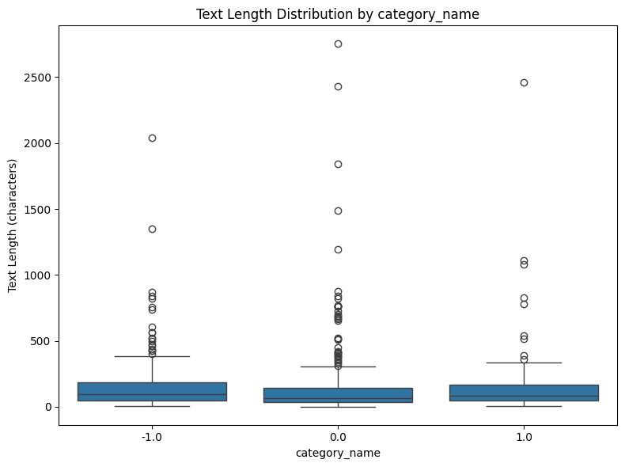
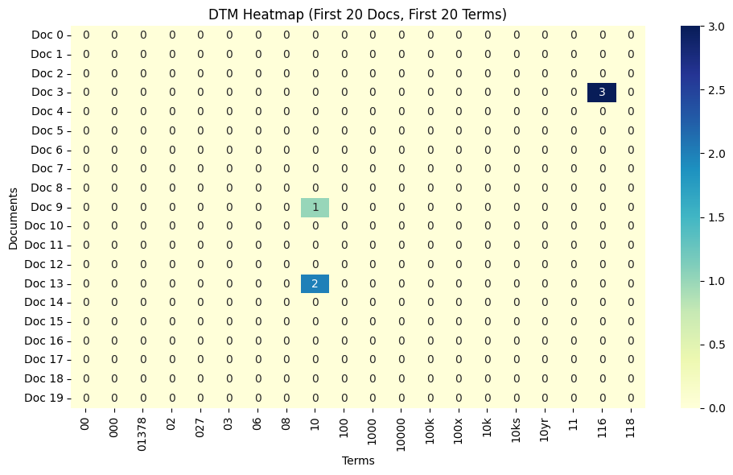
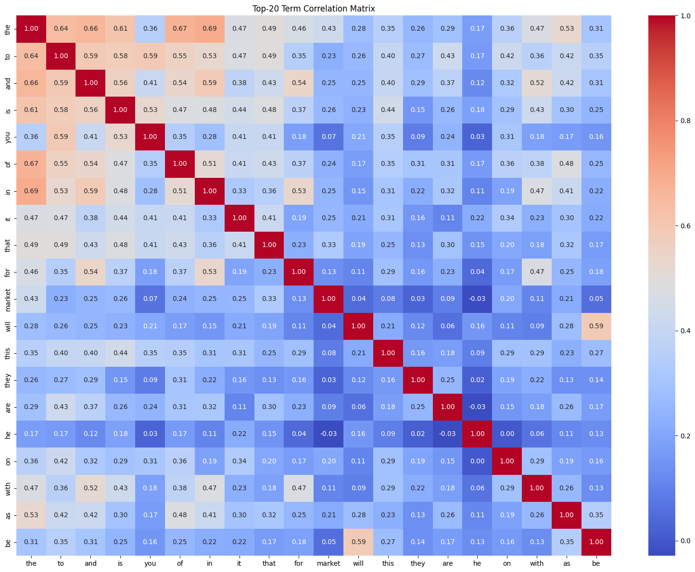
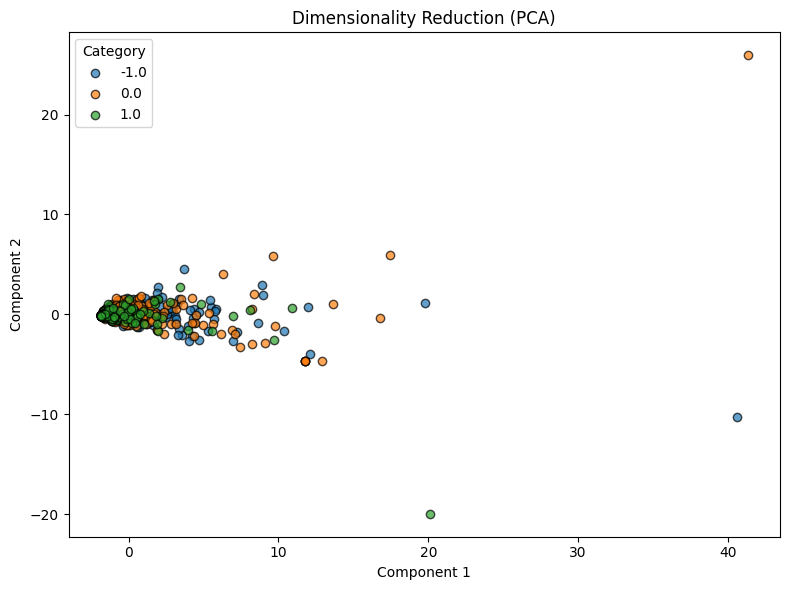

**學生姓名：** 莊財瑋  
**學號：** 115321528  

## 一、 實驗流程與資料品質檢驗

本實驗針對 Reddit 股票情緒資料集（`newdataset/Reddit-stock-sentiment.csv`，紀錄於 `load_dataset_1`）執行完整的文字探勘與特徵工程流程。資料集共包含 847 筆文本記錄，經由 `check_missing_3` 檢查確認無任何缺失值或空文本。在重複值檢測（`check_duplicates_4`）中，發現 23 筆重複文本（佔總體 2.72%）。根據 `describe_data_5` 的敘述性統計分析，文本平均長度為 148.68 個字元，中位數為 79.0 個字元，最長文本達 2,753 個字元。資料集涵蓋三種情緒標籤：中性情緒（`0.0`）共 423 筆、負面情緒（`-1.0`）共 315 筆，以及正面情緒（`1.0`）共 109 筆。整體資料呈現極不對稱的情緒類別分佈。

## 二、 文字斷詞與文件字詞矩陣建構

文本預處理階段透過 `tokenize_6` 進行斷詞，總計提取出 26,386 個 token，平均每篇文件包含 31.15 個字詞。隨後利用 `build_dtm_tool` 建構文件字詞矩陣（`dtm_7`），產生維度為 847 × 4,346 的矩陣，總計 4,346 個獨立詞彙，稀疏度高達 99.53%。經由字詞頻率分析（`tf_8`），出現頻率最高的字詞前幾名依序為 "the" (920次)、"to" (566次)、"and" (488次)、"is" (402次) 及 "it" (350次)。這顯示未經過停用詞（stop words）過濾時，高頻詞幾乎全由虛詞與常用冠詞佔據，顯著影響主題特徵的辨識度。透過 `dtm_heatmap_12` 對前 20 篇文件與前 20 個字詞切片進行熱圖視覺化，明確印證了矩陣極度稀疏的特性。

## 三、 特徵選擇與關聯性分析

在特徵過濾階段，分別執行了變異數過濾（`variance_9`）、Pearson 相關係數過濾（`pearson_10`）與 Spearman 秩相關係數過濾（`spearman_11`）。在預設門檻值 0.0 下，三者皆保留了全部 4,346 個特徵，未刪除任何低變異或低相關字詞。特徵相關性矩陣分析（`feature_corr_13`）選取變異數前 20 大特徵，結果顯示高頻詞之間呈現正相關性（例如 "the" 與 "in" 相關係數達 0.6943，"will" 與 "be" 達 0.5886）。在頻率模式探勘（`mine_patterns_-1.0_14`）中，結果 ID 標示為 `-1.0`，採用 FP-Growth 演算法共探勘出 30 個頻繁模式，支持度最高的單詞包含 "trump" (45)、"just" (42)、"china" (33) 及 "market" (23)。

## 四、 降維、相似度計算與標籤二元化

降維分析方面，`reduce_dim_pca_15` 採用 PCA 將 4,346 維特徵投影至 2 維空間，第一主成分解釋了 27.0027% 的變異，第二主成分解釋了 4.9920% 的變異，累計變異解釋率為 31.9947%，顯示資料在低維度下仍有極高的資訊分散性。相似度分析（`cosine_sim_16`）計算第 0 篇與第 1 篇文件之餘弦相似度，結果為 0.0，反映兩篇文本在字詞選擇上完全無交集。最後，`binarize_labels_17` 使用 `OneHotEncoder` 將三類情緒標籤編碼為二元矩陣（維度 847 × 3），其中負面情緒 `-1.0` 編碼為 `[1, 0, 0]`，中性 `0.0` 編碼為 `[0, 1, 0]`，正面 `1.0` 編碼為 `[0, 0, 1]`。

## 五、 實驗限制與未來改進方向

總結本探勘流程，存在以下顯著限制：
1. **停用詞干擾：** 字詞頻率與特徵矩陣受高頻虛詞（如 "the", "to", "and"）主導，未移除停用詞降低了金融情緒特徵的鑑別力。
2. **過濾門檻過低：** 在 0.0 門檻下，變異數與相關係數過濾未能剔除任何冗餘特徵（保留率 100%）。
3. **頻繁模式粒度受限：** FP-Growth 僅挖掘出單字（unigram）模式，缺乏多詞組合之關聯規則。
4. **PCA 解釋力有限：** 前兩主成分僅能解釋 31.9947% 變異，無法完全捕捉高維文本語意結構。
5. **相似度評估範圍狹窄：** 僅評估兩篇文件間之餘弦相似度（`0.0`），未建立整體語料庫相似度網絡。
6. **未進行預測模型訓練：** 本實驗僅完成資料預處理與特徵探勘，尚未建構股票價格或情緒預測之機器學習模型